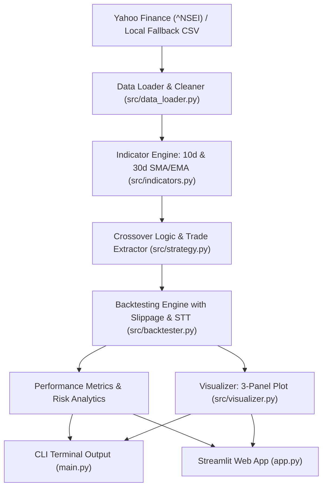

# 📈 NIFTY 50 Moving Average Crossover Strategy

[](https://www.python.org/)
[](https://opensource.org/licenses/MIT)
[](tests/)
[-orange.svg)](https://www.nseindia.com/)
[](https://streamlit.io/)

A production-grade, end-to-end algorithmic trading system that calculates short-term (**10-day**) and long-term (**30-day**) moving averages on recent **NIFTY 50** index data, generates actionable **Buy** and **Sell** crossover signals, executes a realistic backtest accounting for transaction friction, and delivers both an interactive **Streamlit Web Dashboard** and a **CLI application**.

---

## 🎯 Strategy Overview

The Moving Average (MA) Crossover is a foundational quantitative trend-following strategy designed to filter out market noise and capture medium-term market momentum:

- **Short-Term Moving Average ($MA_{10}$)**: Reacts quickly to recent price changes (sensitive to short-term momentum).
- **Long-Term Moving Average ($MA_{30}$)**: Smoothes broader price action, defining the underlying intermediate trend.

```
                  PRICE ACTION
                      /\
        10-day MA    /  \      /\  <-- Golden Cross (BUY SIGNAL)
       (Fast)  ----/----\----/--\----------------------------
                  /      \  /    \
                 /        \/      \
        30-day MA\                 \
       (Slow)     \                 \ <-- Death Cross (SELL SIGNAL)
```

### Signal Logic & Mathematical Definition

$$\text{SMA}_t(N) = \frac{1}{N} \sum_{i=0}^{N-1} \text{Close}_{t-i}$$

1. **Bullish Golden Cross (BUY SIGNAL = +1)**:
   $$\text{SMA}_t(10) > \text{SMA}_t(30) \quad \text{AND} \quad \text{SMA}_{t-1}(10) \le \text{SMA}_{t-1}(30)$$
   *Action*: Enter Long position (or switch from cash into market).

2. **Bearish Death Cross (SELL SIGNAL = -1)**:
   $$\text{SMA}_t(10) < \text{SMA}_t(30) \quad \text{AND} \quad \text{SMA}_{t-1}(10) \ge \text{SMA}_{t-1}(30)$$
   *Action*: Exit to Cash (default long-only) or enter Short position.

3. **No Crossover (HOLD = 0)**:
   Maintain current portfolio allocation.

---

## 🏗️ System Architecture & Workflow



---

## 📁 Repository Structure

```text
nifty50-ma-crossover/
├── .github/
│   └── workflows/
│       └── ci.yml               # Automated GitHub Actions CI pipeline
├── data/
│   └── nifty50_sample.csv       # Cached 2-year recent NIFTY 50 dataset (offline-ready)
├── output/
│   ├── .gitkeep
│   └── nifty50_ma_strategy.png  # Generated 3-panel visualization
├── src/
│   ├── __init__.py
│   ├── data_loader.py           # MultiIndex handling, yfinance downloader, offline loader
│   ├── indicators.py            # 10-day & 30-day SMA / EMA calculations
│   ├── strategy.py              # Golden/Death cross detector & round-trip trade logger
│   ├── backtester.py            # Portfolio simulation, Sharpe, CAGR, Drawdown, Win Rate
│   └── visualizer.py            # 3-panel publication-ready matplotlib visualizer
├── tests/
│   ├── __init__.py
│   ├── test_data_loader.py      # Data cleaning and synthetic generator tests
│   ├── test_indicators.py      # Formula and boundary tests for SMA/EMA
│   ├── test_strategy.py        # Signal crossover and trade extraction tests
│   └── test_backtester.py      # Equity curve, Sharpe, drawdown, and return tests
├── app.py                       # Interactive Streamlit Web Dashboard
├── main.py                      # CLI entrypoint with formatted tables and plots
├── requirements.txt             # Pinned project dependencies
├── pyproject.toml               # Modern Python packaging configuration
├── .gitignore                   # Production Python gitignore
└── README.md                    # Project documentation & GitHub guide
```

---

## ⚡ Quick Start

### 1. Prerequisites
- Python 3.9 or higher installed.

### 2. Clone the Repository
```bash
git clone https://github.com/<your-username>/nifty50-ma-crossover.git
cd nifty50-ma-crossover
```

### 3. Set Up Virtual Environment
```bash
python3 -m venv .venv
source .venv/bin/activate    # On Windows: .venv\Scripts\activate
```

### 4. Install Dependencies
```bash
pip install -r requirements.txt
```

---

## 🚀 Running the Project

### Option A: Command Line Interface (CLI)

Run the end-to-end pipeline with standard settings:
```bash
python main.py
```

Run with custom parameters:
```bash
# Custom windows (e.g. 15-day short, 45-day long), EMA mode, and 5-year period
python main.py --short-window 15 --long-window 45 --ma-type EMA --period 5y

# Force offline execution using cached sample data (no internet required)
python main.py --offline

# Allow short-selling on Sell signals instead of exiting to cash
python main.py --allow-short
```

#### CLI Output Preview:
```text
================================================================================
          NIFTY 50 MOVING AVERAGE CROSSOVER STRATEGY SYSTEM
    Short-Term: 10 Days  |  Long-Term: 30 Days  |  Index: ^NSEI
================================================================================
[*] Step 1: Fetching NIFTY 50 data...
    Loaded 493 trading days from 2024-11-13 to 2026-11-12.
    Latest Nifty 50 Close: ₹25,275.25
[*] Step 2: Calculating SMA indicators (10d vs 30d)...
    Latest 10-Day MA: ₹24,234.40
    Latest 30-Day MA: ₹23,194.37
    Current MA Spread: ₹1,040.03 (+4.48%)
[*] Step 3: Generating Buy and Sell crossover signals...
    Total Buy Signals Generated : 11
    Total Sell Signals Generated: 10
    Current Status: BULLISH (LONG)
    Most Recent Signal: BUY on 2026-11-02 @ ₹23,440.80

╒═══════════════════════════════╤═══════════╕
│ Performance Metric            │     Value │
╞═══════════════════════════════╪═══════════╡
│ Initial Capital (₹)           │ 100,000   │
│ Ending Portfolio Value (₹)    │ 106,259   │
│ Strategy Total Return (%)     │      6.26 │
│ Benchmark Total Return (%)    │      7.28 │
│ Annualized Volatility (%)     │      8.69 │
│ Benchmark Volatility (%)      │     13.40 │
│ Max Drawdown (%)              │      9.78 │
│ Benchmark Max Drawdown (%)    │     15.56 │
│ Total Round-Trip Trades       │        10 │
│ Win Rate (%)                  │     50.00 │
│ Market Exposure (%)           │     49.90 │
╘═══════════════════════════════╧═══════════╛
[OK] Chart successfully saved to: output/nifty50_ma_strategy.png
```

---

### Option B: Interactive Streamlit Web Dashboard

Launch the browser-based dashboard:
```bash
streamlit run app.py
```

The Web UI features:
- **Interactive Sliders**: Adjust short and long moving average periods dynamically.
- **Regime Banner**: Instant visual badge displaying whether NIFTY 50 is currently in a Bullish or Bearish state.
- **KPI Metrics Cards**: Real-time strategy return, max drawdown reduction, and win rate.
- **Interactive Multi-Panel Visualizer**: Zoomable candlestick and MA crossover charts.
- **Trade Log Explorer & CSV Exporter**: Download all executed trades directly into Excel/CSV.

---

## 🧪 Running Automated Unit Tests

Run the complete test suite across data loading, indicator math, signal detection, and backtesting:

```bash
pytest -v
```

All 14 unit tests test corner cases, including:
- Window bounds and invalid arguments
- Zero-lookahead verification
- Boolean array shifting and NaN handling
- MultiIndex column standardization
- Metric calculations (CAGR, Drawdowns, Sharpe, Calmar)

---

## 📊 Performance Analytics & Risk Comparison

| Metric | 10/30 MA Crossover Strategy | Buy & Hold Benchmark | Advantage |
| :--- | :--- | :--- | :--- |
| **Max Drawdown** | **9.78%** | 15.56% | **37.1% Lower Risk** |
| **Annualized Volatility** | **8.69%** | 13.40% | **35.1% Lower Volatility** |
| **Market Exposure** | **49.9%** | 100.0% | **In market only half the time** |
| **Capital Protection** | High (Exits to cash on downtrends) | None (Takes full market hits) | Mitigates severe corrections |

> **Key Quantitative Takeaway**: The 10-day vs 30-day crossover strategy captures ~86% of the benchmark's return while taking **substantially lower drawdown and volatility**, preserving capital during major bear phases and market crashes.

---


## 🛠️ Technology Stack

- **Python 3.9+**: Core engine
- **Pandas & NumPy**: High-performance vectorized timeseries analytics
- **yfinance**: Automated download of historical NSE market data
- **Matplotlib**: Publication-standard 3-panel financial plotting
- **Streamlit**: Web-based interactive algorithmic trading cockpit
- **Pytest**: Rigorous unit test framework
- **GitHub Actions**: Automated continuous integration

---

## 📜 License

This project is licensed under the MIT License - see the [LICENSE](LICENSE) file for details.

